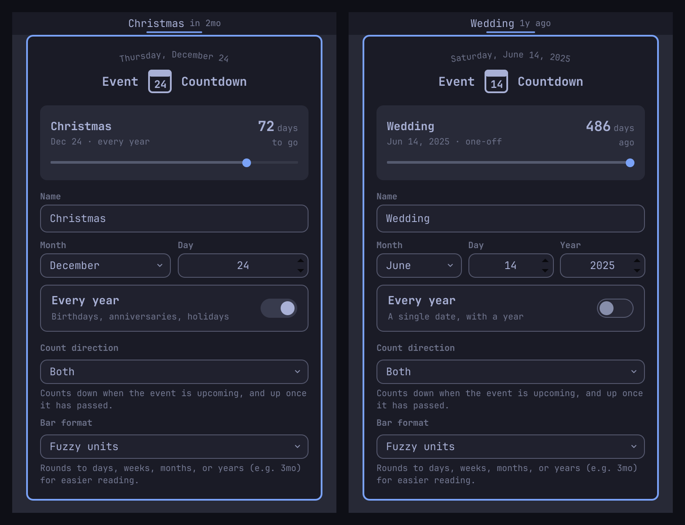

# Event Countdown

Count down (or up) to a birthday, anniversary, deadline, or holiday from the Omarchy bar. Click to set it up.



## Install

```sh
omarchy plugin add https://github.com/SjoenH/omarchy-event-countdown.git --enable
```

## Usage

The bar shows the event's name and how far away it is: `Christmas in 2mo`, `Launch tomorrow`, `Wedding 3d ago`.

Click to open the panel. The card at the top shows the event, its date, the exact number of days to go or ago, and a track that runs from the previous occurrence to the next with today marked on it. It follows the editors below, so you see a change before it is saved.

The event has a **Name**, a **Month** and **Day**, and is either:

- **Every year** (on): birthdays, anniversaries, holidays
- **A single date** (off): deadlines and one-off days, which also take a **Year**

There are no Save or Delete buttons. A change to the date, the toggle or the dropdowns is saved immediately, and the name is saved when the panel closes. Clearing the name removes the event.

**Count direction** decides what the bar counts:

- **Count down**: the time until the next occurrence (`in 14d`)
- **Count up**: the time since the last occurrence (`3d ago`)
- **Both**: down while the event is upcoming, and up once it has passed

**Bar format** decides how it is written:

- **Exact days**: always whole days (`34d`)
- **Fuzzy units**: days, weeks, months, or years (`3mo`)
- **Show date**: the date itself (`→ Dec 24`), switching to a count in the last week

A day that does not exist in a given year lands on the last day of its month, so a February 29 birthday is counted to February 28 outside leap years.

Everything persists across restarts via `shell.json`. The plugin holds one event.

## Default

Ships with no event. Add one from the panel to begin.

## Remove

```sh
omarchy plugin remove no.koka.event-countdown
```

## Development

The spec runs against the real widget and panel, with the installed Omarchy UI kit, in a headless Quickshell. No window appears and `shell.json` is not touched:

```sh
tests/run.sh
```

## Credits

- Panel layout after Omarchy's world clock
- By [koka.no](https://koka.no)

## License

MIT License - See LICENSE file for details
